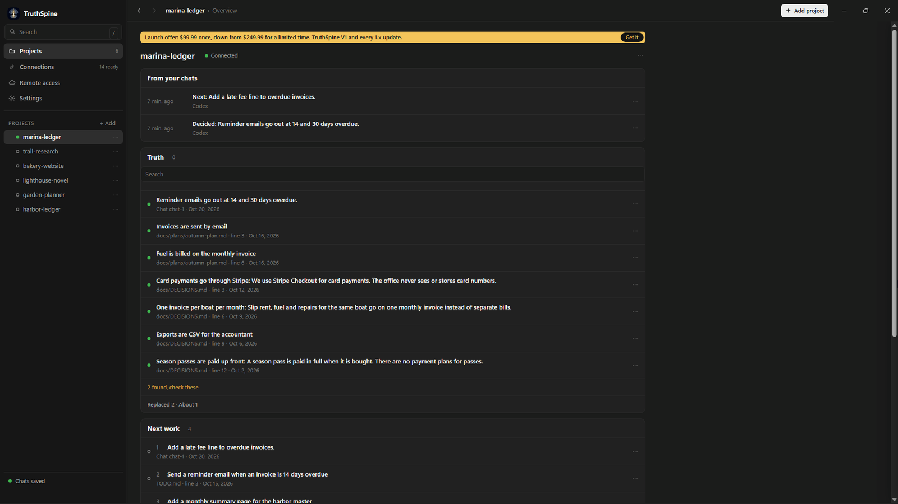

# TruthSpine

**The keeper of your projects. You lead the work. TruthSpine keeps the truth automatically.**

TruthSpine learns your project from its files, follows every AI chat you connect, and keeps one checked record of what was decided and why, what was done, what failed, what is still open, and what comes next. Every connected chat starts already knowing your project. Your project stays on your computer.

## Get it

| | |
| --- | --- |
| **Windows** | [Microsoft Store](https://apps.microsoft.com/detail/9pbn25k75vdj) |
| **Mac** | [Mac App Store](https://apps.apple.com/app/id6794478470) |
| **Linux** | [AppImage](https://truthspine.app/download/linux) from this repository's [releases](https://github.com/TimeProofLabs/truthspine-app/releases) |

14-day free trial, then $99.99 once at the launch price (regular price $249.99). Includes V1 and every 1.x update. No subscription.

## Connect your AI apps

Open TruthSpine and go to **Connections**. It lists the AI apps on your computer as Connected, Ready or Not installed, and sets each one up for you. Then, in a new chat, say **"Connect TruthSpine"**. The chat now knows your project: the current decisions, what was done, and what comes next.

You can also add TruthSpine from your tool:

- **Claude Code:** `/plugin marketplace add TimeProofLabs/truthspine-app`, then `/plugin install truthspine@timeprooflabs`
- **Cursor:** add TruthSpine from the Cursor Marketplace
- **VS Code and Open VSX editors:** "TruthSpine Connector" from the Visual Studio Marketplace or Open VSX
- **JetBrains IDEs:** "TruthSpine Connector" from JetBrains Marketplace
- **Any other MCP tool:** a server named `truthspine` that runs `npx -y @timeprooflabs/truthspine-mcp --host <tool> --project <folder>`
- **MCP Registry:** `app.truthspine/truthspine`

Every tool and how to connect it: [CONNECT.md](CONNECT.md). Each one needs the TruthSpine app on the same computer.

## What TruthSpine does

- Every connected chat starts already knowing your project.
- Decide once. Every chat follows it.
- Shows what's true now, with older decisions set aside.
- Tells what a chat says it did apart from what your files prove.
- Finds decisions and next steps in your files and lists them for you to check. Nothing counts until you confirm it.
- Change any item with one click: move it, mark it done, or mark it no longer true. Nothing is deleted.
- Remembers what failed, so the next chat knows.
- Set a rule once, and every project follows it.
- Handles big, messy projects without slowing down.
- Download the full history any time.

Works with 19 AI apps on your PC: Claude Code, Claude Desktop, Codex, VS Code with GitHub Copilot, GitHub Copilot CLI, Cursor, JetBrains IDEs, OpenCode, Cline, LM Studio, OpenClaw, Hermes Agent, Google Antigravity, Windsurf / Devin, Kiro, Zed, Open WebUI, Droid and Pi. Cloud agents such as ChatGPT, Claude, Meta Muse and Grok can use your project too, through a private connection you set up in your own free Cloudflare account.

## Your project stays on your computer

TruthSpine reads your files and keeps its record on your computer. It holds back passwords and keys. A cloud agent sees your project only if you connect one and say what it may do. Details: [privacy](https://truthspine.app/privacy).

<strong>Trial and price, store by store</strong>

 

On Windows, start the free 14-day trial in the TruthSpine app. Then buy once in the Microsoft Store: $99.99 at the launch price (regular price $249.99), for V1 and every 1.x update. Reinstalling does not restart the trial.

On Mac, start the free 14-day trial in the TruthSpine app. Then buy once in the App Store: $99.99 at the launch price (regular price $249.99), for V1 and every 1.x update. Restore Purchases brings it back on your other Macs.

On Linux, the AppImage starts with a free 14-day trial. Then buy once from us: $99.99 at the launch price (regular price $249.99), for V1 and every 1.x update, on up to three of your own Linux computers. You can move it between them in the app.

Future major versions are separate purchases. Installing a connector does not start a trial or need its own license.

## About this repository

This is TruthSpine's public home: the connectors, release notes, support and discussion, and the Linux AppImage on [releases](https://github.com/TimeProofLabs/truthspine-app/releases). The app itself comes from the Microsoft Store, the Mac App Store or the Linux AppImage. Its source code is not published.

**License:** Apache-2.0 for this repository's contents (connectors and docs). See [LICENSE](LICENSE). The TruthSpine app is closed source.

## Help

- [Report a problem](https://github.com/TimeProofLabs/truthspine-app/issues/new/choose)
- [Ask a question or share an idea](https://github.com/TimeProofLabs/truthspine-app/discussions)
- [Privacy](https://truthspine.app/privacy) · [Security](https://truthspine.app/security) · [Support](https://truthspine.app/support)
- Email: support@truthspine.app
